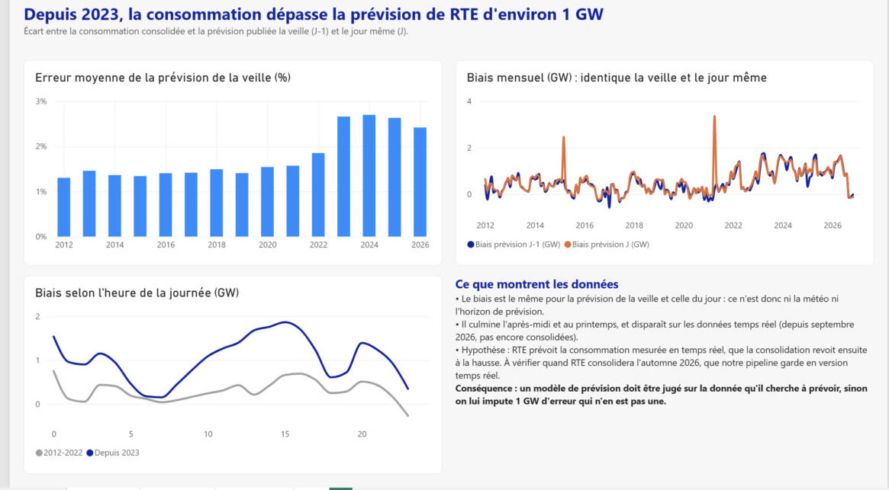

# La prévision de RTE s'est-elle dégradée depuis 2023 ?

*Note d'analyse, novembre 2026. Données : RTE éCO2mix (ODRÉ, Licence Ouverte v2.0), Open-Meteo (CC BY 4.0).
Rapport Power BI : [`powerbi/`](powerbi/). Calculs reproductibles depuis `fct_national_heure`.*

## Réponse courte

Non. L'erreur apparente a presque doublé : **1,48 %** d'erreur moyenne de 2012 à 2022, **2,69 %** depuis 2023.
Mais ce n'est presque pas une erreur de prévision. C'est un **écart entre deux versions de la donnée** :
- la prévision de RTE vise la consommation mesurée en temps réel ;
- l'historique publié est la version consolidée, revue à la hausse depuis 2023.

Comparée à la donnée temps réel, la prévision retrouve sa précision d'avant 2022.

## Ce que montrent les données

| Comparaison (prévision de la veille) | Biais moyen | Erreur moyenne |
|---|---|---|
| Consolidé, 2012-2022 | +0,31 GW | 1,48 % |
| Consolidé, 2023 à août 2026 | **+1,10 GW** | **2,69 %** |
| Consolidé, septembre-novembre 2023-2025 | +0,97 GW | 2,45 % |
| **Temps réel, septembre-novembre 2026** | **−0,10 GW** | **1,31 %** |

Biais : consommation réelle moins prévision. Positif, la consommation dépasse la prévision.

1. **Le biais est systématique, pas aléatoire.** Depuis 2023, la consommation consolidée dépasse la prévision
   de 1,1 GW en moyenne, presque toutes les heures et tous les mois.
2. **Il est identique pour la prévision de la veille et pour celle du jour même.** Une erreur de météo ou
   d'horizon diminuerait à l'approche du jour J. Celle-ci ne bouge pas.
3. **Il a un profil horaire marqué.** Il culmine entre 13 h et 15 h (+1,8 à +2,0 GW) et au printemps.
4. **Il disparaît sur la donnée temps réel.** Sur les mêmes mois de l'année, le biais passe de +0,97 GW (consolidé)
   à −0,10 GW (temps réel), et l'erreur de 2,45 % à 1,31 %.

## Interprétation et limites

L'explication la plus cohérente avec ces quatre faits : depuis 2023, la consolidation ajoute à la consommation
une part que la mesure temps réel ne voit pas. Le profil (pic en début d'après-midi, au printemps) fait penser
à l'autoconsommation solaire. C'est une **hypothèse** : les données ne permettent pas de la prouver.

Deux limites :
- la comparaison temps réel ne couvre que trois mois (septembre-novembre 2026), contre trois ans pour le consolidé ;
- les deux versions ne se recouvrent pas encore : le consolidé s'arrête en août 2026, le temps réel commence en septembre.

**Comment trancher :** quand RTE publiera la version consolidée de l'automne 2026, notre pipeline aura les deux versions
des mêmes heures, car il archive chaque collecte temps réel au lieu de l'écraser. La révision se mesurera alors directement,
heure par heure. Le DAG `historique` recharge déjà le consolidé chaque semaine : il restera à écrire le modèle dbt de comparaison.

## Recommandations

1. **Pour évaluer un modèle de prévision** (le nôtre en semaine 3, ou tout autre) : le comparer à la version
   de la donnée qu'il cherche à prévoir. Sinon, on lui impute 1 GW d'erreur qui n'en est pas une.
2. **Pour un acteur qui utilise l'historique consolidé** (calibrage, planification) : corriger le changement
   de niveau de 2023, sans quoi un modèle entraîné sur 2012-2022 sous-estimera durablement la consommation.

## Deux autres constats du rapport

- **Thermosensibilité.** Chaque degré en moins sous 15 °C coûte environ 2 250 MW à l'échelle des 12 régions,
  cohérent avec l'ordre de grandeur de 2 400 MW/°C cité par RTE. Rapportée à leur consommation, la Bretagne, les Pays de la Loire
  et l'Occitanie y sont presque deux fois plus sensibles (environ 4,5 % par degré) que le Grand Est ou les Hauts-de-France
  (environ 2,5 à 3 %). Piste à vérifier : la part du chauffage électrique.
- **CO₂.** En 2025, l'électricité française a émis 18,9 g/kWh en moyenne, contre 65,6 en 2013. Les heures
  les plus décarbonées sont entre 12 h et 14 h (16 g/kWh), les plus carbonées vers 20-21 h (22 g/kWh). Décaler une recharge
  du soir vers midi réduit ses émissions d'environ 28 %.
