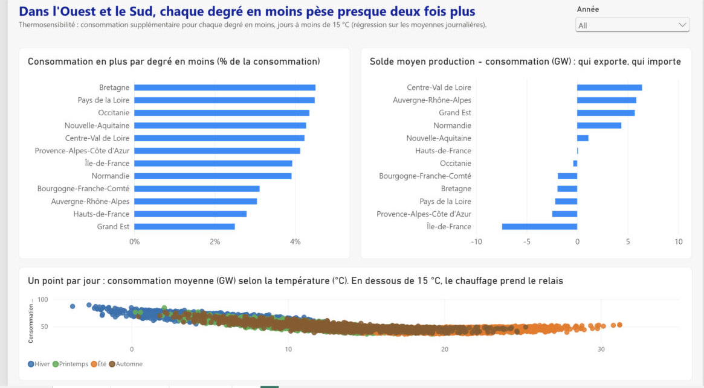

# Le réseau électrique français en temps réel

Pipeline de données de bout en bout sur la consommation et la production d'électricité en France,
par région et par quart d'heure, depuis 2013 et en continu, croisée avec la météo.

> Projet en cours. Fait : collecte, orchestration, entrepôt, tests de qualité, rapport Power BI et note d'analyse.
> À venir : prévision de consommation comparée à celle de RTE (MLflow, FastAPI), carte 3D (Next.js, deck.gl).

**Résultat principal** ([note d'analyse](ANALYSE.md)) : l'erreur de la prévision de RTE semble avoir doublé depuis 2023
(1,5 % → 2,7 %). En réalité, la prévision vise la consommation mesurée en temps réel, et c'est la version consolidée qui a
été revue d'environ +1 GW. Comparée à la donnée temps réel, la prévision retrouve sa précision d'avant 2022 (1,3 %).


## Architecture

```
API ODRÉ (RTE éCO2mix)                 API Open-Meteo
  régional + national                    12 préfectures de région
  ├─ temps réel, toutes les 15 min       ├─ prévision (7 j passés, 2 j à venir), toutes les heures
  └─ consolidé depuis 2012, hebdo        └─ archive ERA5 depuis 2012, hebdo
                    └──────────┬─────────────┘
                               ▼
              src/collecte : reprises, écriture atomique, collecte incrémentale
                               ▼
              data/raw/*.parquet   (brut, jamais modifié)
                               ▼
              dbt + DuckDB
                staging : stg_eco2mix, stg_eco2mix_national, stg_meteo   (typé, dédoublonné)
                marts   : fct_region_heure, fct_national_heure            (prêt pour l'analyse)
                               ▲
              Airflow 3 (LocalExecutor, PostgreSQL), dans Docker Compose
```

| Table | Grain | Contenu |
|---|---|---|
| `fct_region_heure` | région × heure | consommation, production par filière, solde import/export, température, ensoleillement, vent |
| `fct_national_heure` | heure | consommation, prévisions J-1 et J de RTE et leur erreur, mix, part bas carbone, CO₂, température pondérée |
| `fct_region_jour` | région × jour | moyennes journalières (consommation, solde, température), pour la thermosensibilité |
| `dim_region` | région | nom, préfecture et coordonnées du point météo (seed dbt, lu aussi par la collecte météo) |

## Rapport Power BI

Le rapport est versionné au format projet Power BI (PBIP) : le modèle sémantique en TMDL
([`powerbi/reseau-electrique.SemanticModel/definition`](powerbi/reseau-electrique.SemanticModel/definition)) et les
pages générées par [`powerbi/generer_rapport.py`](powerbi/generer_rapport.py). Il lit les fichiers Parquet que dbt
écrit dans `data/export` (paramètre `DossierExport` à adapter après un clone).

- **Modèle** : faits `National` (heure) et `Région jour`, dimensions `Régions` et `Calendrier` (table DAX), en étoile.
- **Mesures DAX** : CO₂ pondéré par la consommation, part bas carbone, erreur et biais de la prévision de RTE,
  thermosensibilité par régression linéaire (`LINESTX`), absolue et relative.
- **4 pages** : vue d'ensemble, prévision de RTE, régions et météo, CO₂.

| | |
|---|---|
|  |  |
|  |  |

## Choix techniques

- **Collecte incrémentale avec recouvrement** : chaque passage recollecte les 6 dernières heures, car RTE
  complète les derniers quarts d'heure après coup. Les doublons sont résolus dans dbt (le consolidé l'emporte sur
  le temps réel, puis la collecte la plus récente).
- **Reprise après panne** : l'API temps réel garde environ 3 mois. Après une coupure, la collecte suivante rattrape
  le trou toute seule, à partir du dernier horodatage enregistré. Les requêtes HTTP sont relancées avec un délai croissant.
- **Écriture atomique** : un fichier n'apparaît qu'une fois complet et validé.
- **Types instables** : une même colonne peut arriver en nombre ou en texte selon l'export, donc tout est converti
  explicitement dans la couche staging.
- **Pas de temps hétérogène** : 30 min dans les anciennes années, 15 min ensuite. Les marts raisonnent en MW moyens par heure.
- **Météo observée ou prévue** : la colonne `source` les distingue. Le futur modèle de prévision ne pourra pas
  utiliser une météo qu'il n'aurait pas connue au moment de prévoir.
- **Un seul écrivain DuckDB** : seul le DAG temps réel lance dbt. Les marts sont écrits en Parquet
  (matérialisation `external` de dbt-duckdb) : c'est la frontière avec Power BI et, demain, avec l'API.
  L'entrepôt garde les chemins de l'environnement qui l'a construit : depuis Windows, reconstruire en entier
  (`dbt build`) plutôt qu'une sélection, ou ouvrir l'entrepôt en lecture seule.

## Qualité des données

24 tests dbt tournent à chaque passage : unicité, valeurs non nulles, bornes physiques (consommation,
CO₂, température), fraîcheur de la collecte (moins de 4 h), et cohérence entre la somme des 12 régions
et la consommation nationale. Un test en échec fait échouer le DAG.

Ce que les tests ont déjà trouvé dans les données de RTE :
- une consommation de **0 MW en Île-de-France** le 23/08/2026 à 18 h, en réalité une valeur manquante, écartée ;
- à la même heure, un écart de 14 % entre la somme des régions et le national, signalé en avertissement ;
- en temps réel, la somme des régions s'écarte du national de 2 à 5 % les midis ensoleillés, et le consolidé
  corrige ensuite. En moyenne sur l'historique, l'écart est de 0,01 %.

## Autres constats

- Chaque degré en moins sous 15 °C coûte environ **2 250 MW** sur les 12 régions. Rapportée à sa consommation, la Bretagne
  y est presque deux fois plus sensible (≈ 4,5 %/°C) que le Grand Est (≈ 2,5 %/°C).
- En 2025, l'électricité française a émis **18,9 g de CO₂/kWh** en moyenne (65,6 en 2013). Les heures de 12 h à 14 h sont
  environ 28 % moins carbonées que celles de 20-21 h.

## Démarrer

```bash
docker compose up -d --build        # Airflow sur http://localhost:18080
```

Au premier démarrage, déclencher le DAG `historique` dans l'interface (environ 15 min, ~130 Mo).

Sans Docker :

```bash
python -m venv .venv && .venv/Scripts/pip install -r requirements.txt
export PYTHONPATH=src
python -m collecte consolide && python -m collecte meteo && python -m collecte temps-reel
cd dbt && dbt build --profiles-dir .
cd .. && pytest
```

## Données et licences

- éCO2mix de [RTE](https://www.rte-france.com/eco2mix), diffusé par [ODRÉ](https://odre.opendatasoft.com)
  sous [Licence Ouverte v2.0 (Etalab)](https://www.etalab.gouv.fr/wp-content/uploads/2017/04/ETALAB-Licence-Ouverte-v2.0.pdf).
- Météo [Open-Meteo](https://open-meteo.com) (réanalyse ERA5 de Copernicus et modèles de prévision), sous
  [CC BY 4.0](https://creativecommons.org/licenses/by/4.0/).
