# Le réseau électrique français en temps réel

Pipeline de données de bout en bout sur la consommation et la production d'électricité en France,
par région et par quart d'heure, depuis 2013 et en continu, croisée avec la météo : collecte, orchestration,
entrepôt testé, rapport Power BI, prévision J+1 servie par une API, et une carte 3D qui rejoue n'importe quelle heure.

**▶ Voir l'application en ligne : https://yohannkp.github.io/reseau-electrique-fr/** (mise à jour chaque heure)

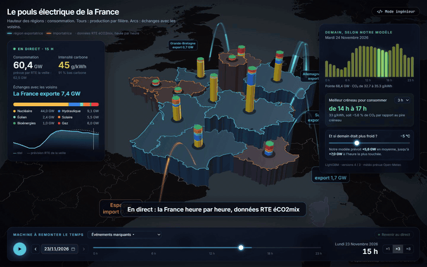

*Parcours de l'application en 40 s : le direct, le survol d'une région, la lecture d'une journée, la pointe record de 2018
(la France importe), le record solaire (elle exporte), la prévision de demain et le scénario de froid, puis le mode ingénieur.
[Version MP4 en pleine résolution](docs/demo/demo.mp4). La hauteur des régions suit leur consommation, les tours leur
production par filière, le liseré leur solde (cyan : exportatrice, ambre : importatrice).*

**Présentation détaillée** : [docs/presentation/reseau-electrique-fr.pptx](docs/presentation/reseau-electrique-fr.pptx),
61 diapositives avec notes orateur. Pourquoi ce projet, mise en place étape par étape, code, choix techniques et
alternatives écartées, pièges rencontrés, et 20 questions d'entretien avec leurs réponses.

**Stack** : Python, Airflow 3, dbt + DuckDB, Parquet, LightGBM, MLflow, FastAPI, Docker Compose, Power BI (PBIP),
Next.js + deck.gl, GitHub Actions.

**Résultat principal** ([note d'analyse](ANALYSE.md)) : l'erreur de la prévision de RTE semble avoir doublé depuis 2023
(1,5 % → 2,7 %). En réalité, la prévision vise la consommation mesurée en temps réel, et c'est la version consolidée qui a
été revue d'environ +1 GW. Comparée à la donnée temps réel, la prévision retrouve sa précision d'avant 2022 (1,3 %).


## Architecture

```
API ODRÉ (RTE éCO2mix)                 API Open-Meteo
  régional + national                    12 préfectures de région
  ├─ temps réel, toutes les 15 min       ├─ prévision (7 j passés, 2 j à venir), toutes les heures
  └─ consolidé depuis 2012, hebdo        └─ archive ERA5 depuis 2012, hebdo
                    └──────────┬─────────────┘
                               ▼
              src/collecte : reprises, écriture atomique, collecte incrémentale
                               ▼
              data/raw/*.parquet   (brut, jamais modifié)
                               ▼
              dbt + DuckDB
                staging : stg_eco2mix, stg_eco2mix_national, stg_meteo   (typé, dédoublonné)
                marts   : fct_region_heure, fct_national_heure            (prêt pour l'analyse)
                               ▲
              Airflow 3 (LocalExecutor, PostgreSQL), dans Docker Compose
                               ▼
              data/export/*.parquet ──► Power BI
                               └──────► prévision LightGBM ──► MLflow (suivi, registre) ──► API FastAPI ──► carte 3D (Next.js, deck.gl)
```

| Table | Grain | Contenu |
|---|---|---|
| `fct_region_heure` | région × heure | consommation, production par filière, solde import/export, température, ensoleillement, vent |
| `fct_national_heure` | heure | consommation, prévisions J-1 et J de RTE et leur erreur, mix, part bas carbone, CO₂, température pondérée |
| `fct_region_jour` | région × jour | moyennes journalières (consommation, solde, température), pour la thermosensibilité |
| `dim_region` | région | nom, préfecture et coordonnées du point météo (seed dbt, lu aussi par la collecte météo) |

## Carte 3D : « le pouls électrique de la France »

Application Next.js + deck.gl ([`web/`](web/)) branchée sur l'API.

- **Carte 3D** : socles régionaux (consommation, solde), tours de production empilées par filière, arcs animés
  vers les 5 frontières (impulsions dans le sens des échanges), éclairage directionnel.
- **Machine à remonter le temps** : n'importe quelle journée depuis 2013, lecture heure par heure, et 8 journées
  remarquables calculées depuis les données (pointe record, record solaire, record d'export, journée la plus carbonée…).
  Lien direct vers un instant : `?jour=2018-02-28&heure=19`.
- **Demain** : prévision de notre modèle (consommation et CO₂), meilleur créneau bas carbone, et scénario
  « et si demain était plus froid ? » recalculé par le modèle.
- **Mode ingénieur** : fraîcheur de chaque source, résultats des tests dbt, état des DAG Airflow, versions et erreurs
  des modèles en production, volumes exportés. Tout est lu en direct, rien n'est simulé.

| | |
|---|---|
| 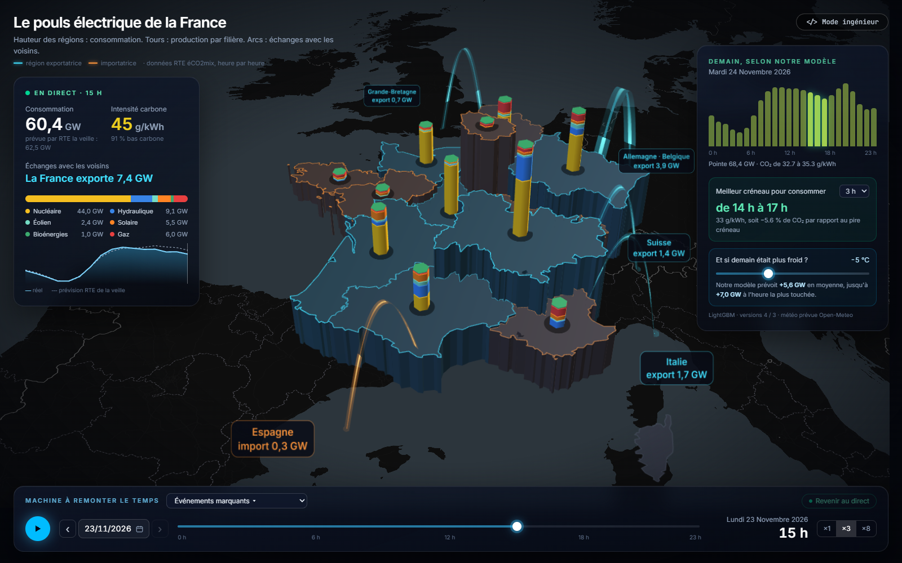 | 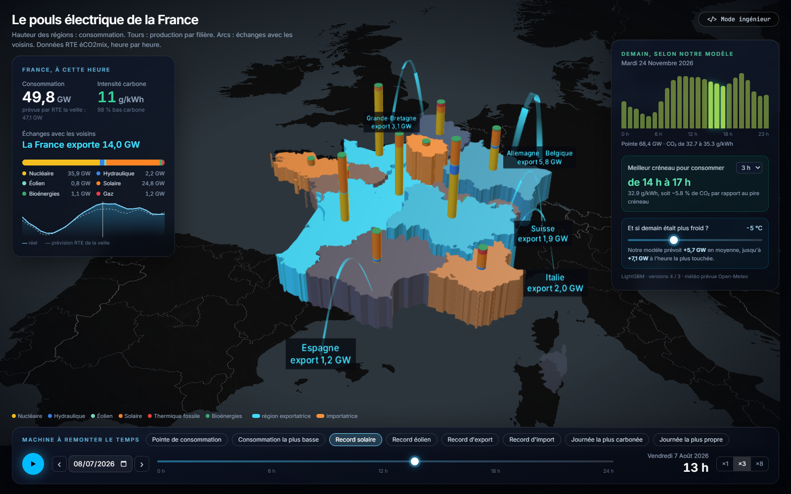 |
| 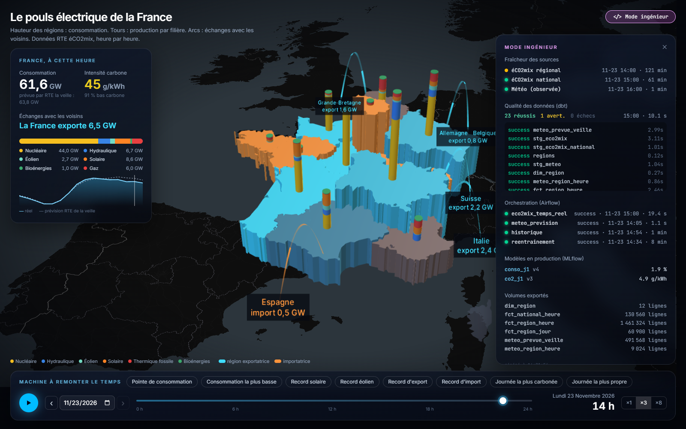 | 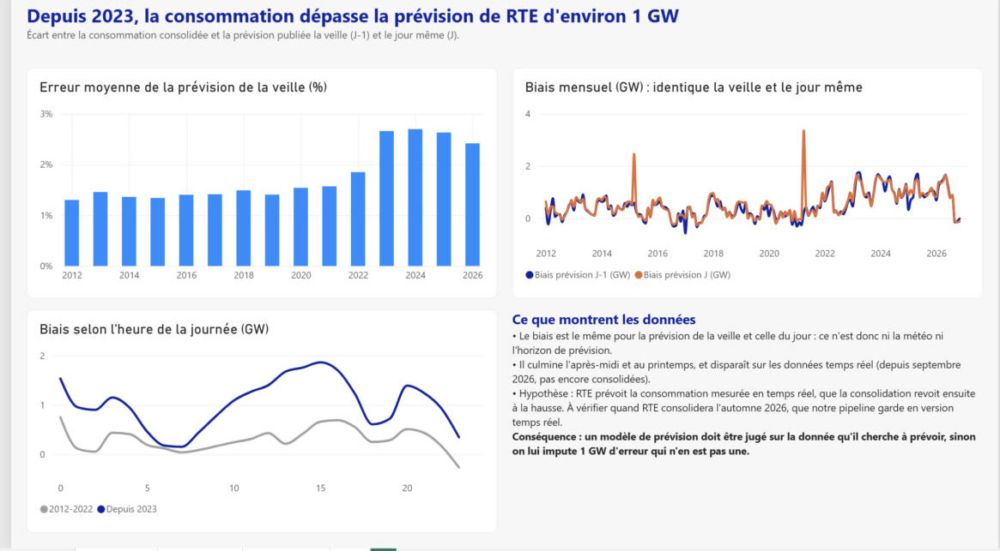 |

Endpoints ajoutés pour l'app : `/periode`, `/carte/regions`, `/carte/national` (dont les échanges commerciaux par frontière),
`/journees-remarquables`, `/pipeline`, `/scenario/froid`.

## Prévision J+1 et meilleur créneau bas carbone

Deux modèles LightGBM prévoient, la veille à midi, la consommation nationale et le taux de CO₂ de chaque heure du lendemain.
Ils sont suivis et versionnés dans MLflow, réentraînés chaque lundi par Airflow, et servis par une API FastAPI.

**Évaluation honnête.** Les périodes ne se recouvrent jamais : apprentissage 2013-2023, réglage 2024 (choix des
variantes, voir [`prevision/essais.py`](src/prevision/essais.py)), test janvier 2025 → août 2026. Au test, le modèle reçoit
la météo **telle qu'elle était prévue la veille** (archive Open-Meteo), pas la météo observée après coup. Un test
automatique vérifie qu'aucune variable n'utilise une donnée postérieure à la veille à midi.

| Consommation, test 2025 → août 2026 | Erreur | Erreur moyenne |
|---|---|---|
| Base naïve (même heure, semaine précédente) | 6,59 % | 3 502 MW |
| Prévision de la veille de RTE | 2,70 % | 1 344 MW |
| RTE corrigé de son biais mesuré en 2024 | 2,05 % | 1 023 MW |
| **Notre modèle** | **1,95 %** | **1 013 MW** |

Sur la consommation consolidée, le modèle fait jeu égal avec RTE une fois le biais de RTE corrigé
(voir la [note d'analyse](ANALYSE.md) pour l'origine de ce biais). **Sur la donnée temps réel (septembre-novembre 2026),
RTE reste nettement meilleur : 1,3 % d'erreur contre 1,8 %.** RTE dispose de bien plus d'informations
(mises à jour dans la journée, grands consommateurs, météo plus fine).

| CO₂, test 2025 → août 2026 | Erreur moyenne |
|---|---|
| Base naïve (même heure, semaine précédente) | 6,96 g/kWh |
| Base naïve (même heure, avant-veille) | 5,56 g/kWh |
| **Notre modèle** | **4,85 g/kWh** (−13 %) |

RTE ne publie pas de prévision du taux de CO₂ dans éCO2mix : c'est ce qui rend l'API utile.

**API** (http://localhost:18000/docs) :
- `GET /prevision?jour=AAAA-MM-JJ` : consommation et CO₂ prévus pour chaque heure (par défaut demain) ;
- `GET /meilleur-creneau?duree_h=3` : le créneau le moins carboné pour placer une consommation (recharge d'un véhicule,
  calcul lourd), avec le gain par rapport au pire créneau et à la moyenne ;
- `GET /sante`, `POST /recharger` : versions des modèles servis, rechargement après réentraînement.

**Choix de modélisation** : cible relative (écart au niveau de la matinée de la veille) plutôt que valeur brute, plus
robuste aux changements de régime (le CO₂ est passé d'environ 50 à environ 20 g/kWh) ; perte L1 ; même nombre d'arbres
pour le modèle final, réentraîné sur tout l'historique.

## Deux façons de faire tourner le projet

| | Version complète (Docker) | Version en ligne (GitHub Pages) |
|---|---|---|
| Orchestration | Airflow 3, 5 DAG (collecte toutes les 15 min) | workflow GitHub Actions chaque heure ([publication.yml](.github/workflows/publication.yml)) |
| Modèles | serveur MLflow : suivi, registre, alias « production » | MLflow en mode fichier (SQLite), même code d'entraînement |
| Données servies | API FastAPI | fichiers JSON générés par les fonctions de l'API ([publication/statique.py](src/publication/statique.py)) |
| Carte 3D | toute l'histoire depuis 2013 | 14 derniers jours et journées remarquables |
| Coût | un PC ou un serveur | 0 €, aucun serveur |

La version en ligne réutilise exactement le même code : le générateur appelle les fonctions de l'API, ce qui dépend
d'un paramètre est précalculé (meilleur créneau de 1 à 12 h, scénario de froid de −10 à +5 °C), et l'app lit des fichiers
au lieu de l'API. Le mode ingénieur y affiche les étapes du workflow à la place des DAG.

### Airflow et MLflow dans la version complète

| | |
|---|---|
| 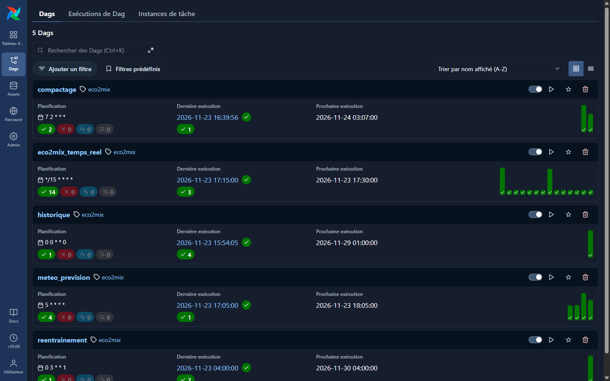 | 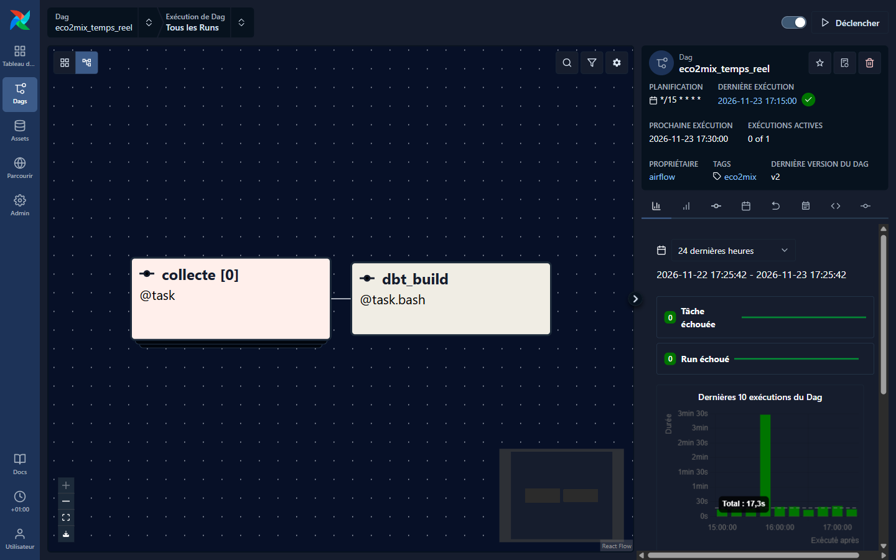 |
| *Les 5 DAG, leur planification et leurs dernières exécutions* | *collecte (une tâche par périmètre, en parallèle) puis dbt build* |
| 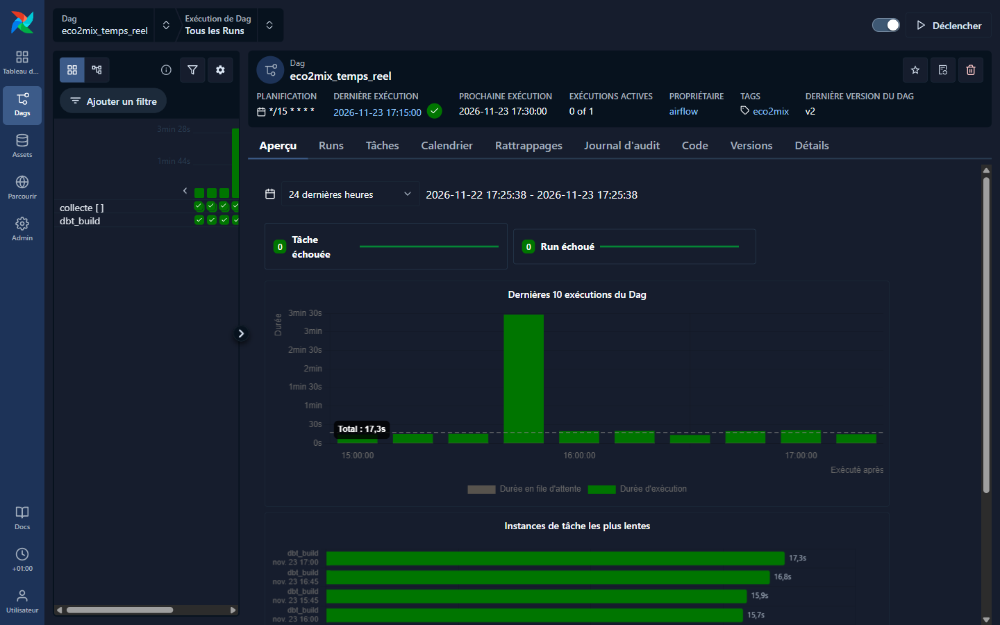 | 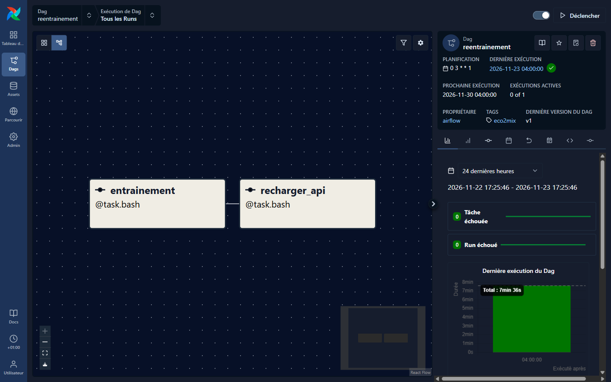 |
| *Durée des 10 dernières exécutions, tâches les plus lentes* | *Chaque lundi : entraînement puis rechargement de l'API* |
| 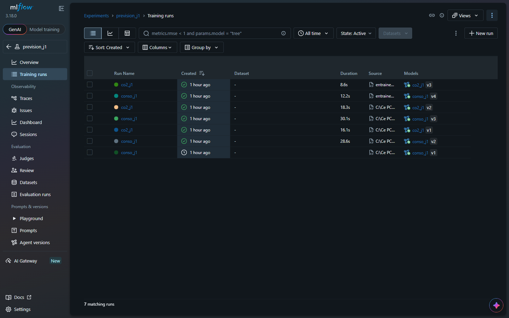 | 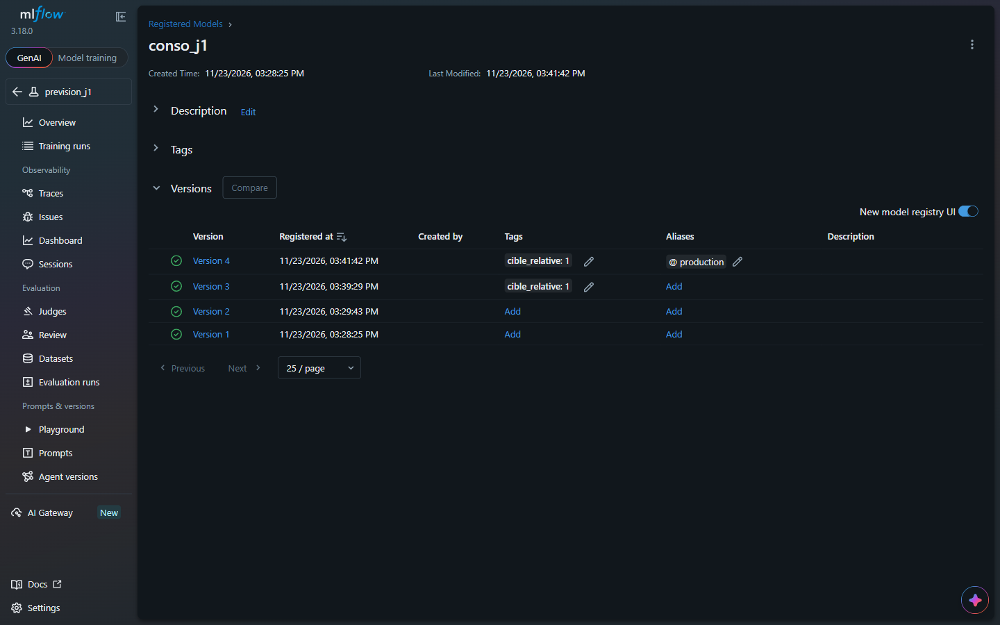 |
| *Chaque entraînement tracé, avec sa version de modèle* | *Registre : versions, alias « production », tag cible_relative* |

## Rapport Power BI

Le rapport est versionné au format projet Power BI (PBIP) : le modèle sémantique en TMDL
([`powerbi/reseau-electrique.SemanticModel/definition`](powerbi/reseau-electrique.SemanticModel/definition)) et les
pages générées par [`powerbi/generer_rapport.py`](powerbi/generer_rapport.py). Il lit les fichiers Parquet que dbt
écrit dans `data/export` (paramètre `DossierExport` à adapter après un clone).

- **Modèle** : faits `National` (heure) et `Région jour`, dimensions `Régions` et `Calendrier` (table DAX), en étoile.
- **Mesures DAX** : CO₂ pondéré par la consommation, part bas carbone, erreur et biais de la prévision de RTE,
  thermosensibilité par régression linéaire (`LINESTX`), absolue et relative.
- **4 pages** : vue d'ensemble, prévision de RTE, régions et météo, CO₂.

| | |
|---|---|
| 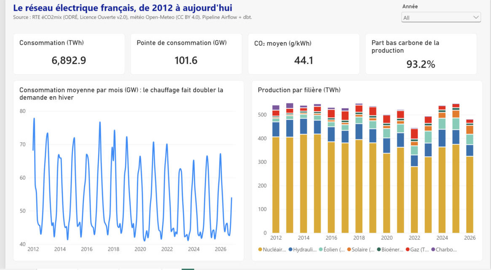 |  |
|  | 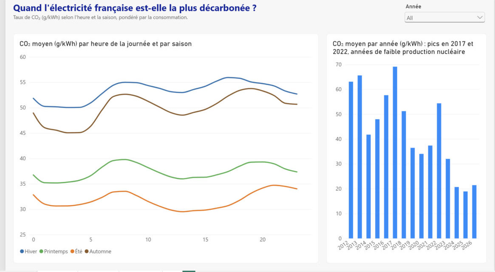 |

## Choix techniques

- **Collecte incrémentale avec recouvrement** : chaque passage recollecte les 6 dernières heures, car RTE
  complète les derniers quarts d'heure après coup. Les doublons sont résolus dans dbt (le consolidé l'emporte sur
  le temps réel, puis la collecte la plus récente).
- **Reprise après panne** : l'API temps réel garde environ 3 mois. Après une coupure, la collecte suivante rattrape
  le trou toute seule, à partir du dernier horodatage enregistré. Les requêtes HTTP sont relancées avec un délai croissant.
- **Écriture atomique** : un fichier n'apparaît qu'une fois complet et validé.
- **Compactage nocturne** : la collecte écrit environ 200 petits fichiers par jour (70 000 par an), que dbt devrait
  tous ouvrir à chaque passage. Chaque nuit (DAG `compactage`, entre deux passages de dbt), les fichiers d'une journée
  terminée sont fusionnés en un seul qui garde la dernière version de chaque mesure ; écriture atomique avant suppression.
- **Sobriété** : prévisions mises en cache 15 min dans l'API (250 ms → 5 ms) ; serveur MLflow réduit à un processus
  sans exécuteur de tâches (2,6 Go → 0,4 Go de RAM) ; la stack complète tient en environ 2,4 Go.
- **Types instables** : une même colonne peut arriver en nombre ou en texte selon l'export, donc tout est converti
  explicitement dans la couche staging.
- **Pas de temps hétérogène** : 30 min dans les anciennes années, 15 min ensuite. Les marts raisonnent en MW moyens par heure.
- **Météo observée ou prévue** : la colonne `source` les distingue, et l'archive des prévisions de la veille sert au test. Le modèle de prévision ne doit
  pas utiliser de météo qu'il n'aurait pas connue au moment de prévoir.
- **Un seul écrivain DuckDB** : seul le DAG temps réel lance dbt. Les marts sont écrits en Parquet
  (matérialisation `external` de dbt-duckdb) : c'est la frontière avec Power BI et avec l'API.
  L'entrepôt garde les chemins de l'environnement qui l'a construit : depuis Windows, reconstruire en entier
  (`dbt build`) plutôt qu'une sélection, ou ouvrir l'entrepôt en lecture seule.

## Qualité des données

24 tests dbt tournent à chaque passage : unicité, valeurs non nulles, bornes physiques (consommation,
CO₂, température), fraîcheur de la collecte (moins de 4 h), et cohérence entre la somme des 12 régions
et la consommation nationale. Un test en échec fait échouer le DAG.

Ce que les tests ont déjà trouvé dans les données de RTE :
- une consommation de **0 MW en Île-de-France** le 23/08/2026 à 18 h, en réalité une valeur manquante, écartée ;
- à la même heure, un écart de 14 % entre la somme des régions et le national, signalé en avertissement ;
- en temps réel, la somme des régions s'écarte du national de 2 à 5 % les midis ensoleillés, et le consolidé
  corrige ensuite. En moyenne sur l'historique, l'écart est de 0,01 %.

## Autres constats

- Chaque degré en moins sous 15 °C coûte environ **2 250 MW** sur les 12 régions. Rapportée à sa consommation, la Bretagne
  y est presque deux fois plus sensible (≈ 4,5 %/°C) que le Grand Est (≈ 2,5 %/°C).
- En 2025, l'électricité française a émis **18,9 g de CO₂/kWh** en moyenne (65,6 en 2013). Les heures de 12 h à 14 h sont
  environ 28 % moins carbonées que celles de 20-21 h.

## Démarrer

```bash
docker compose up -d --build
# Airflow http://localhost:18080 · MLflow http://localhost:15000 · API http://localhost:18000/docs
cd web && npm install && npm run build && npm start        # carte 3D http://localhost:3000
```

Au premier démarrage, déclencher le DAG `historique` dans l'interface (environ 15 min, ~150 Mo), puis `reentrainement`.

Sans Docker :

```bash
python -m venv .venv && .venv/Scripts/pip install -r requirements.txt
export PYTHONPATH=src
python -m collecte consolide && python -m collecte meteo && python -m collecte temps-reel
cd dbt && dbt build --profiles-dir .
cd .. && pytest
```

## Données et licences

- éCO2mix de [RTE](https://www.rte-france.com/eco2mix), diffusé par [ODRÉ](https://odre.opendatasoft.com)
  sous [Licence Ouverte v2.0 (Etalab)](https://www.etalab.gouv.fr/wp-content/uploads/2017/04/ETALAB-Licence-Ouverte-v2.0.pdf).
- Météo [Open-Meteo](https://open-meteo.com) (réanalyse ERA5 de Copernicus et modèles de prévision), sous
  [CC BY 4.0](https://creativecommons.org/licenses/by/4.0/).
- Contours des régions : [france-geojson](https://github.com/gregoiredavid/france-geojson), d'après IGN Admin Express
  (Licence Ouverte). Fond de carte © [CARTO](https://carto.com/attributions), © contributeurs OpenStreetMap.
